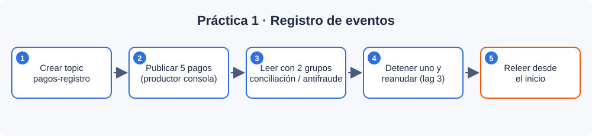

# Práctica 1. Recorrer el registro de eventos con la CLI

**Capítulo 1. El paradigma de Kafka**

⏱️ **Duración:** 45 min · 🛠️ **Herramienta:** CLI de Apache Kafka 4.2 · 📄 **Entregable:** Bitácora ACT-01

## Descripción

Una entidad financiera ficticia registra cada pago como un evento. Dos áreas, Conciliación y Antifraude, necesitan leer los mismos pagos a su propio ritmo. En esta práctica el participante crea el topic de pagos, publica eventos con el productor de consola y los lee con dos consumidores de grupos distintos. Comprueba que leer no borra el evento, que un consumidor detenido retoma donde se quedó y que el registro se puede releer desde el inicio, y contrasta lo observado con una cola tradicional.

## Objetivos de aprendizaje

Al finalizar la práctica, el participante será capaz de:

- Crear un topic y publicar y leer eventos con las herramientas de consola de Kafka.
- Comprobar que dos grupos de consumidores reciben todos los eventos de forma independiente.
- Explicar con evidencia de la CLI la retención, la reanudación por offset y la relectura del registro.
- Distinguir tres diferencias entre Kafka y una cola tradicional a partir de lo observado.



## Antes de empezar

| Elemento | Valor |
|---|---|
| Dónde trabajar | Terminal de la máquina virtual del curso (bash) |
| Variable de conexión | `$BOOTSTRAP` (definida en el [Setup Guide](../../Setup_Guide.md)) |
| Topic de la práctica | `pagos-registro` (1 partición) |
| Grupos de consumidores | `conciliacion-[INICIALES]` y `antifraude-[INICIALES]` |
| Nombre del entregable | `ACT01_Bitacora_[INICIALES].md` en `~/entregables/` |

> Sustituya `[INICIALES]` por sus iniciales en minúsculas en nombres de grupos y archivos (por ejemplo, `conciliacion-lmr`). Todos los datos de la práctica son ficticios.

<!-- Nota para el instructor: los temas 1.1 y 1.2 (30 min) se exponen antes de la práctica. Mostrar en pantalla la disposición de las tres terminales antes de iniciar la Tarea 2. -->

---

## Tarea 1. Preparar la bitácora y crear el topic de pagos (8 min)

**Objetivo:** Tener el topic `pagos-registro` creado con 1 partición y la bitácora iniciada con la primera predicción.

**Por qué:** El topic es el registro donde se conservarán los pagos. Con una sola partición todo el orden es visible a simple vista y la atención queda en el comportamiento del registro, no en el reparto.

**Paso 1.** Abrir una terminal en la máquina virtual y comprobar que la variable de conexión está definida:

```bash
echo $BOOTSTRAP
kafka-topics.sh --version
```

- **Qué verás:** la dirección del clúster con el formato `IP:PUERTO` y la versión `4.2.x` de las herramientas.
- **Si no ocurre así:** si `echo` no muestra nada, ejecutar `source ~/.kafka-curso.env`. Si `kafka-topics.sh` no se encuentra, revisar la sección *Variables de Entorno* del [Setup Guide](../../Setup_Guide.md).

**Paso 2.** Crear la carpeta de entregables y la bitácora:

```bash
mkdir -p ~/entregables
cat > ~/entregables/ACT01_Bitacora_[INICIALES].md <<'EOF'
# ACT-01. Bitácora

## Predicción 1
Si dos consumidores de grupos distintos leen el mismo topic, espero que...

EOF
```

**Paso 3.** Abrir la bitácora con `nano ~/entregables/ACT01_Bitacora_[INICIALES].md` y completar la **Predicción 1** con una o dos líneas. Guardar con **Ctrl+O**, **Enter** y salir con **Ctrl+X**.

- **Importante:** escribir la predicción antes de ejecutar. El criterio de evaluación contrasta lo esperado con lo observado.

**Paso 4.** Crear el topic con una partición:

```bash
kafka-topics.sh --bootstrap-server $BOOTSTRAP \
  --create --topic pagos-registro \
  --partitions 1 --replication-factor 1
```

- **Qué verás:** `Created topic pagos-registro.`
- **Si no ocurre así:** si aparece `TopicExistsException`, el topic ya existe; continuar con el paso 5.

**Paso 5.** Describir el topic y anotar en la bitácora el número de particiones y el valor de `retention.ms`:

```bash
kafka-topics.sh --bootstrap-server $BOOTSTRAP --describe --topic pagos-registro
kafka-configs.sh --bootstrap-server $BOOTSTRAP --describe --all \
  --entity-type topics --entity-name pagos-registro | grep retention.ms
```

- **Qué verás:** `PartitionCount: 1`, `Leader: 0` y `retention.ms=604800000` (7 días, valor predeterminado).

**Al terminar esta tarea debes tener:**

- ✔ El topic `pagos-registro` con 1 partición.
- ✔ La Predicción 1 escrita en la bitácora.

---

## Tarea 2. Publicar pagos y leerlos con dos grupos distintos (12 min)

**Objetivo:** Obtener la salida de dos consumidores, uno por grupo, que muestran los mismos 5 pagos con los mismos offsets.

**Por qué:** En una cola, un mensaje entregado a un receptor ya no está disponible para otro. En Kafka cada grupo lleva su propia posición en el registro, por lo que Conciliación y Antifraude reciben todos los pagos.

**Paso 1.** Organizar tres terminales en la máquina virtual: **T1** para el productor, **T2** para Conciliación y **T3** para Antifraude. En cada terminal nueva, comprobar `echo $BOOTSTRAP`.

**Paso 2.** En **T2**, iniciar el consumidor de Conciliación:

```bash
kafka-console-consumer.sh --bootstrap-server $BOOTSTRAP \
  --topic pagos-registro --group conciliacion-[INICIALES] \
  --property print.offset=true --property print.timestamp=true
```

- **Qué verás:** el cursor queda en espera, sin mensajes.

**Paso 3.** En **T3**, iniciar el consumidor de Antifraude con el mismo comando, cambiando únicamente el grupo a `antifraude-[INICIALES]`.

**Paso 4.** En **T1**, iniciar el productor de consola:

```bash
kafka-console-producer.sh --bootstrap-server $BOOTSTRAP --topic pagos-registro
```

**Paso 5.** En **T1**, escribir los siguientes pagos, uno por línea, presionando **Enter** después de cada uno:

```text
{"idPago":"P-0001","cuenta":"CTA-1001","monto":1500.00,"moneda":"MXN"}
{"idPago":"P-0002","cuenta":"CTA-2002","monto":320.50,"moneda":"MXN"}
{"idPago":"P-0003","cuenta":"CTA-1001","monto":89.90,"moneda":"MXN"}
{"idPago":"P-0004","cuenta":"CTA-3003","monto":12000.00,"moneda":"MXN"}
{"idPago":"P-0005","cuenta":"CTA-2002","monto":45.00,"moneda":"MXN"}
```

- **Qué verás:** en **T2** y **T3** aparecen los cinco pagos, con `Offset:0` a `Offset:4` en ambas terminales.

**Paso 6.** Copiar la salida de **T2** y de **T3** a la bitácora bajo el título `## Evidencia 1. Dos grupos, mismos eventos` y anotar si coincide con la Predicción 1.

**Al terminar esta tarea debes tener:**

- ✔ Los cinco pagos visibles en ambos consumidores con offsets 0 a 4.
- ✔ La Evidencia 1 registrada en la bitácora.

---

## Tarea 3. Detener un consumidor y comprobar que retoma donde quedó (12 min)

**Objetivo:** Obtener la descripción del grupo `antifraude-[INICIALES]` con lag 3 mientras está detenido y la salida que muestra que, al volver, lee solo los pagos P-0006 a P-0008.

**Por qué:** El grupo confirma (commit) su offset en el clúster. Un consumidor que se detiene no pierde eventos ni vuelve a leer los ya procesados.

**Paso 1.** Agregar a la bitácora la **Predicción 2**: qué leerá Antifraude al volver si mientras está detenido se publican tres pagos.

**Paso 2.** En **T3**, detener el consumidor de Antifraude con **Ctrl+C**.

- **Qué verás:** `Processed a total of 5 messages`.

**Paso 3.** En **T1**, publicar tres pagos más:

```text
{"idPago":"P-0006","cuenta":"CTA-3003","monto":700.00,"moneda":"MXN"}
{"idPago":"P-0007","cuenta":"CTA-1001","monto":15.75,"moneda":"MXN"}
{"idPago":"P-0008","cuenta":"CTA-4004","monto":2300.00,"moneda":"MXN"}
```

- **Qué verás:** solo **T2** (Conciliación) muestra los offsets 5, 6 y 7.

**Paso 4.** En **T3**, describir el grupo detenido:

```bash
kafka-consumer-groups.sh --bootstrap-server $BOOTSTRAP \
  --describe --group antifraude-[INICIALES]
```

- **Qué verás:** el aviso `Consumer group 'antifraude-...' has no active members.` y una fila con `CURRENT-OFFSET 5`, `LOG-END-OFFSET 8` y `LAG 3`.

**Paso 5.** En **T3**, volver a iniciar el consumidor de Antifraude con el mismo comando de la Tarea 2, paso 3.

- **Qué verás:** aparecen únicamente los pagos P-0006, P-0007 y P-0008 (offsets 5 a 7).

**Paso 6.** Copiar a la bitácora la salida del `--describe` y la del consumidor reanudado bajo `## Evidencia 2. Reanudación` y comparar con la Predicción 2.

**Al terminar esta tarea debes tener:**

- ✔ La descripción del grupo con `LAG 3` mientras estaba detenido.
- ✔ La salida que muestra la reanudación desde el offset 5.

---

## Tarea 4. Releer el registro desde el inicio (6 min)

**Objetivo:** Obtener una salida con los ocho pagos leídos de nuevo desde el offset 0, sin alterar la posición de los grupos de la práctica.

**Por qué:** Los eventos se conservan según la política de retención, no según si ya se leyeron. Esto permite reconstruir un estado, auditar o incorporar un consumidor nuevo que necesite el historial.

**Paso 1.** Detener los consumidores de **T2** y **T3** con **Ctrl+C**. Dejar **T1** abierta.

**Paso 2.** En **T2**, leer el topic completo desde el inicio sin indicar grupo:

```bash
kafka-console-consumer.sh --bootstrap-server $BOOTSTRAP \
  --topic pagos-registro --from-beginning \
  --property print.offset=true --max-messages 8
```

- **Qué verás:** los ocho pagos, de `Offset:0` a `Offset:7`, y `Processed a total of 8 messages`.

**Paso 3.** Comprobar que la relectura no cambió la posición de Conciliación:

```bash
kafka-consumer-groups.sh --bootstrap-server $BOOTSTRAP \
  --describe --group conciliacion-[INICIALES]
```

- **Qué verás:** `CURRENT-OFFSET 8` y `LAG 0`. La relectura usó un grupo temporal propio.

**Paso 4.** Copiar ambas salidas a la bitácora bajo `## Evidencia 3. Relectura`.

**Al terminar esta tarea debes tener:**

- ✔ Los ocho pagos releídos desde el offset 0.
- ✔ Evidencia de que el grupo `conciliacion-[INICIALES]` mantiene su offset.

---

## Tarea 5. Contrastar Kafka con una cola tradicional (7 min)

**Objetivo:** Tener la bitácora completa con tres diferencias entre Kafka y una cola tradicional, cada una apoyada en una evidencia.

**Por qué:** El resto del curso parte de este cambio de mentalidad: leer un evento no es consumirlo en el sentido de una cola.

**Paso 1.** Agregar a la bitácora la sección `## Diferencias con una cola tradicional` con la siguiente estructura y completarla:

```text
| # | En una cola tradicional... | En Kafka observé... | Evidencia |
|---|---|---|---|
| 1 | Un mensaje entregado a un receptor ya no está disponible para otro | | Evidencia 1 |
| 2 | | | Evidencia 2 |
| 3 | | | Evidencia 3 |
```

**Paso 2.** Agregar una sección `## Discrepancias` con cualquier diferencia entre las predicciones y lo observado, y su explicación. Si no hubo, escribir `Sin discrepancias`.

**Paso 3.** Detener el productor de **T1** con **Ctrl+C** y comprobar que el archivo está completo:

```bash
grep -c "Evidencia" ~/entregables/ACT01_Bitacora_[INICIALES].md
```

- **Qué verás:** un número mayor o igual a 6.

**Al terminar esta tarea debes tener:**

- ✔ La tabla de tres diferencias con su evidencia.
- ✔ La bitácora guardada en `~/entregables/`.

---

## Validación y pruebas

| Caso | Acción | Resultado esperado |
|---|---|---|
| Caso 1 | Publicar 5 pagos con dos consumidores activos de grupos distintos | Ambos muestran los 5 pagos con offsets 0 a 4 |
| Caso 2 | Detener Antifraude, publicar 3 pagos y describir su grupo | `LAG 3`; al reiniciar lee solo los offsets 5 a 7 |
| Caso 3 | Leer con `--from-beginning` sin grupo | Se muestran los 8 pagos; el lag de Conciliación sigue en 0 |
| Caso adversarial | Reiniciar Antifraude agregando `--from-beginning` con el mismo grupo | No relee: el grupo ya tiene offset confirmado y `--from-beginning` solo aplica a grupos sin offset |

## Resultado esperado

- Dos grupos de consumidores leyeron los mismos eventos de forma independiente.
- Un consumidor detenido retomó exactamente donde se quedó.
- El registro completo se releyó desde el inicio sin afectar a los grupos.

**Entregable:** Bitácora con las predicciones previas, las salidas de la CLI y una explicación de tres diferencias entre Kafka y una cola tradicional basadas en lo observado (`ACT01_Bitacora_[INICIALES].md`).

<!-- Agregar captura del resultado final: ../../images/p01-resultado.png -->

## Solución de problemas

**El consumidor no muestra mensajes**
- *Síntoma:* el productor acepta líneas, pero ningún consumidor las muestra.
- *Causa:* el consumidor se inició con un grupo que ya tenía offsets confirmados al final del topic, o se conectó a otro topic.
- *Solución:* comprobar el nombre del topic en ambos comandos y describir el grupo con `kafka-consumer-groups.sh --describe`.

**Error de conexión al broker**
- *Síntoma:* `Connection to node -1 could not be established` o `Timed out waiting for a node assignment`.
- *Causa:* la variable `$BOOTSTRAP` no está definida en esa terminal o el clúster no está listo.
- *Solución:* ejecutar `source ~/.kafka-curso.env` y `kubectl get kafka -n kafka`; esperar a que `READY` sea `True`.

**Aviso de propiedad obsoleta**
- *Síntoma:* el consumidor muestra un aviso sobre `--property`.
- *Causa:* Kafka 4.x introduce opciones con nombres nuevos para el formateador.
- *Solución:* el aviso no impide la práctica; continuar.

## Limpieza

- Conservar el topic `pagos-registro` y la bitácora en `~/entregables/`. No eliminar los grupos de consumidores.

## Recursos opcionales

- [Apache Kafka 4.2. Design](https://kafka.apache.org/42/design/design/)
- [Apache Kafka 4.2. Quick Start](https://kafka.apache.org/42/getting-started/quickstart/)
- [Strimzi 1.2.0. Deploying](https://strimzi.io/docs/operators/1.2.0/deploying)

<sub>Complejidad: Fácil · Nivel de Bloom: Comprender · Resultado de aprendizaje que verifica: R1</sub>

---

[Inicio](../../README.md) | [Siguiente: Práctica 2 ➡](../../Capitulo02/Practica02/README.md)
