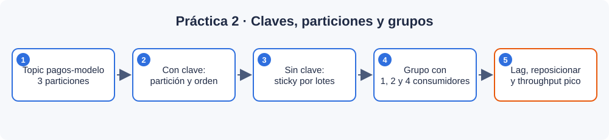

# Práctica 2. Comprobar el efecto de claves, particiones y grupos de consumidores

**Capítulo 2. Topics, particiones, claves y offsets**

⏱️ **Duración:** 67 min · 🛠️ **Herramienta:** CLI de Apache Kafka 4.2 · 📄 **Entregable:** Bitácora ACT-02

## Descripción

La entidad financiera ficticia necesita que los pagos de una misma cuenta se procesen en orden y que el consumo escale cuando crece el volumen. En esta práctica el participante publica pagos con y sin clave en un topic de tres particiones, predice y comprueba dónde cae cada evento, levanta varios consumidores en un mismo grupo, mide el lag, reposiciona el grupo y calcula el throughput pico de un escenario de tráfico. Con esto puede anticipar cómo se distribuirán y ordenarán los eventos de su propia aplicación.

## Objetivos de aprendizaje

Al finalizar la práctica, el participante será capaz de:

- Comprobar que la clave determina la partición y que el orden se conserva por cuenta dentro de una partición.
- Explicar la distribución por lotes del particionador sticky cuando los eventos no tienen clave.
- Explicar cómo un grupo reparte las particiones y por qué un consumidor de más queda sin asignación.
- Medir lag, reposicionar un grupo y calcular el throughput pico en mensajes/s y MB/s.



## Antes de empezar

| Elemento | Valor |
|---|---|
| Dónde trabajar | Terminal de la máquina virtual del curso (bash), con cinco terminales disponibles |
| Variable de conexión | `$BOOTSTRAP` (definida en el [Setup Guide](../../Setup_Guide.md)) |
| Topic de la práctica | `pagos-modelo` (3 particiones) |
| Grupo de consumidores | `modelo-[INICIALES]` |
| Carpeta de trabajo | `~/act02/` |
| Nombre del entregable | `ACT02_Bitacora_[INICIALES].md` en `~/entregables/` |

> Sustituya `[INICIALES]` por sus iniciales en minúsculas. Todos los datos de la práctica son ficticios.

---

## Tarea 1. Crear el topic de tres particiones y registrar las predicciones (8 min)

**Objetivo:** Tener el topic `pagos-modelo` con 3 particiones y la tabla de predicciones por cuenta escrita en la bitácora.

**Por qué:** La partición es la unidad de orden y de paralelismo. Antes de publicar, el participante debe anticipar qué ocurrirá con los pagos de cada cuenta.

**Paso 1.** Crear el topic y la carpeta de trabajo:

```bash
mkdir -p ~/act02 ~/entregables && cd ~/act02
kafka-topics.sh --bootstrap-server $BOOTSTRAP \
  --create --topic pagos-modelo --partitions 3 --replication-factor 1
kafka-topics.sh --bootstrap-server $BOOTSTRAP --describe --topic pagos-modelo
```

- **Qué verás:** `PartitionCount: 3` y tres filas, `Partition: 0`, `1` y `2`, todas con `Leader: 0`.

**Paso 2.** Crear la bitácora con la tabla de predicciones:

```bash
cat > ~/entregables/ACT02_Bitacora_[INICIALES].md <<'EOF'
# ACT-02. Bitácora

## Predicciones por cuenta
| Cuenta | ¿Todos sus pagos en la misma partición? (sí/no) | Partición observada | ¿Orden 1-2-3-4 conservado? |
|---|---|---|---|
| CTA-1001 | | | |
| CTA-2002 | | | |
| CTA-3003 | | | |
| CTA-4004 | | | |
| CTA-5005 | | | |

## Predicción sin clave
Si publico 3000 pagos sin clave, espero que se distribuyan...

## Predicción de consumidores
Con 1, 2 y 4 consumidores en el mismo grupo, espero que...
EOF
```

**Paso 3.** Abrir la bitácora con `nano` y completar la segunda columna de la tabla y las dos predicciones. Guardar y salir.

**Al terminar esta tarea debes tener:**

- ✔ El topic `pagos-modelo` con 3 particiones.
- ✔ Las predicciones escritas antes de publicar.

---

## Tarea 2. Publicar pagos con la cuenta como clave y comprobar partición y orden (14 min)

**Objetivo:** Obtener la tabla de predicciones completa, con la partición observada de cada cuenta y la confirmación de que sus pagos 1 a 4 aparecen en orden.

**Por qué:** Kafka calcula la partición a partir de un hash de la clave. Si la clave es el número de cuenta, todos los pagos de una cuenta caen en la misma partición y se leen en el orden en que se publicaron.

**Paso 1.** Generar un archivo con 20 pagos: cuatro por cuenta, intercalados, con la clave antes del separador `|`:

```bash
for sec in 1 2 3 4; do
  for cta in 1001 2002 3003 4004 5005; do
    echo "CTA-$cta|{\"idPago\":\"P-$cta-$sec\",\"cuenta\":\"CTA-$cta\",\"secuencia\":$sec,\"monto\":$((sec*100)).00}"
  done
done > pagos-con-clave.txt
head -6 pagos-con-clave.txt
```

**Paso 2.** Publicar el archivo indicando que cada línea trae clave:

```bash
kafka-console-producer.sh --bootstrap-server $BOOTSTRAP --topic pagos-modelo \
  --property parse.key=true --property key.separator='|' < pagos-con-clave.txt
```

- **Qué verás:** el comando termina sin mensajes de error.

**Paso 3.** Leer los 20 pagos mostrando partición, offset y clave:

```bash
kafka-console-consumer.sh --bootstrap-server $BOOTSTRAP --topic pagos-modelo \
  --from-beginning --max-messages 20 \
  --property print.partition=true --property print.offset=true --property print.key=true \
  | tee salida-con-clave.txt
```

- **Qué verás:** líneas con el formato `Partition:N  Offset:M  CTA-XXXX  {...}`.

**Paso 4.** Agrupar la salida por cuenta para comprobar la partición y el orden:

```bash
for cta in 1001 2002 3003 4004 5005; do
  echo "== CTA-$cta"
  grep "\"cuenta\":\"CTA-$cta\"" salida-con-clave.txt \
    | sed -E 's/^(Partition:[0-9]+)[[:space:]]+(Offset:[0-9]+).*"secuencia":([0-9]+).*/\1 \2 secuencia:\3/'
done
```

- **Qué verás:** para cada cuenta, cuatro líneas con la misma `Partition` y `secuencia` 1, 2, 3, 4 en offsets crecientes.
- **Alternativa:** si el filtro no muestra resultados, ejecutar `grep CTA-1001 salida-con-clave.txt` para cada cuenta y revisar la columna de partición a simple vista.

**Paso 5.** Completar las columnas *Partición observada* y *¿Orden conservado?* en la bitácora y agregar `salida-con-clave.txt` bajo `## Evidencia 1. Clave y orden`.

- **Importante:** varias cuentas pueden compartir partición. Lo que la clave garantiza es que una cuenta no se reparte entre particiones, no que cada cuenta tenga una propia.

**Al terminar esta tarea debes tener:**

- ✔ Cada cuenta con sus cuatro pagos en una sola partición y en orden.
- ✔ La tabla de predicciones completa.

---

## Tarea 3. Publicar sin clave y observar el particionador sticky (10 min)

**Objetivo:** Obtener el conteo de eventos por partición y la evidencia de que, sin clave, los pagos llegan a cada partición en bloques consecutivos.

**Por qué:** Sin clave no hay garantía de orden por cuenta. El productor llena un lote para una partición antes de cambiar a otra (particionador sticky), lo que mejora el rendimiento pero rompe la intuición de un reparto uno a uno.

**Paso 1.** Generar 3000 pagos sin clave, numerados en el campo `n`:

```bash
RELLENO=$(printf 'x%.0s' {1..200})
for n in $(seq 1 3000); do
  echo "{\"n\":$n,\"cuenta\":\"CTA-$((1000 + n % 50))\",\"monto\":10.00,\"relleno\":\"$RELLENO\"}"
done > pagos-sin-clave.txt
wc -l pagos-sin-clave.txt
```

**Paso 2.** Registrar los offsets finales antes de publicar, publicar el archivo y registrar los offsets finales después:

```bash
kafka-get-offsets.sh --bootstrap-server $BOOTSTRAP --topic pagos-modelo > offsets-antes.txt
kafka-console-producer.sh --bootstrap-server $BOOTSTRAP --topic pagos-modelo < pagos-sin-clave.txt
kafka-get-offsets.sh --bootstrap-server $BOOTSTRAP --topic pagos-modelo > offsets-despues.txt
paste offsets-antes.txt offsets-despues.txt
```

- **Qué verás:** tres líneas `pagos-modelo:N:offset`; la diferencia por partición indica cuántos pagos sin clave recibió cada una. Normalmente no es un reparto exacto de 1000.

**Paso 3.** Leer solo la partición 0 y detectar dónde cambia la secuencia de `n`:

```bash
kafka-console-consumer.sh --bootstrap-server $BOOTSTRAP --topic pagos-modelo \
  --partition 0 --offset earliest --timeout-ms 10000 2>/dev/null \
  | grep -o '"n":[0-9]*' | cut -d: -f2 \
  | awk 'NR==1{ini=$1; prev=$1; next} $1!=prev+1{print "bloque", ini, "-", prev; ini=$1} {prev=$1} END{print "bloque", ini, "-", prev}'
```

- **Qué verás:** varias líneas `bloque X - Y`: rangos consecutivos de pagos que se enviaron juntos a la partición 0.
- **Si no ocurre así:** si aparece un solo bloque, la partición recibió un solo lote; repetir el comando con `--partition 1` y `--partition 2`.

**Paso 4.** Copiar los conteos y los bloques a la bitácora bajo `## Evidencia 2. Sin clave` y explicar en dos líneas por qué no se reparte uno a uno.

**Al terminar esta tarea debes tener:**

- ✔ El conteo de pagos sin clave por partición.
- ✔ Al menos un rango de bloques consecutivos en una partición.

---

## Tarea 4. Repartir las particiones con uno, dos y cuatro consumidores (15 min)

**Objetivo:** Obtener tres registros de asignación del grupo `modelo-[INICIALES]`: con 1, 2 y 4 miembros, donde el cuarto miembro no tiene particiones.

**Por qué:** Dentro de un grupo, cada partición se asigna a un solo consumidor. El número de particiones es el límite de consumidores activos del grupo.

**Paso 1.** En **T2**, iniciar el primer consumidor del grupo, leyendo desde el inicio:

```bash
kafka-console-consumer.sh --bootstrap-server $BOOTSTRAP --topic pagos-modelo \
  --group modelo-[INICIALES] --from-beginning --property print.partition=true > /dev/null
```

- **Qué verás:** el cursor queda en espera; la salida se descarta para no llenar la pantalla.

**Paso 2.** En **T1**, esperar 10 segundos y describir los miembros del grupo:

```bash
kafka-consumer-groups.sh --bootstrap-server $BOOTSTRAP \
  --describe --group modelo-[INICIALES] --members --verbose | tee asignacion-1.txt
```

- **Qué verás:** un miembro con `#PARTITIONS 3` y `ASSIGNMENT pagos-modelo(0,1,2)`.

**Paso 3.** En **T3**, iniciar un segundo consumidor con el mismo comando del paso 1. Esperar 10 segundos y repetir el paso 2 guardando en `asignacion-2.txt`.

- **Qué verás:** dos miembros; uno con 2 particiones y otro con 1. El cambio de asignación es un rebalanceo.

**Paso 4.** En **T4** y **T5**, iniciar el tercer y el cuarto consumidor con el mismo comando. Esperar 10 segundos y repetir el paso 2 guardando en `asignacion-4.txt`.

- **Qué verás:** cuatro miembros; tres con `#PARTITIONS 1` y uno con `#PARTITIONS 0`.

**Paso 5.** Copiar los tres archivos a la bitácora bajo `## Evidencia 3. Asignaciones` y explicar por qué el cuarto consumidor no recibe particiones.

**Paso 6.** Detener los cuatro consumidores con **Ctrl+C** en **T2**, **T3**, **T4** y **T5**.

**Al terminar esta tarea debes tener:**

- ✔ Tres registros de asignación (1, 2 y 4 miembros).
- ✔ La explicación del consumidor sin asignación.

---

## Tarea 5. Medir el lag y reposicionar el grupo (12 min)

**Objetivo:** Obtener la medición del lag del grupo detenido, la evidencia del reposicionamiento con `--shift-by -5` y la salida del reproceso de los 15 eventos.

**Por qué:** El lag es la distancia entre lo publicado y lo confirmado por el grupo. Reposicionar permite reprocesar eventos, por ejemplo después de corregir un error en el consumidor.

**Paso 1.** Con el grupo detenido, publicar 30 pagos con clave reutilizando el archivo de la Tarea 2 (cada línea se publica una vez más, más 10 líneas adicionales):

```bash
cat pagos-con-clave.txt <(head -10 pagos-con-clave.txt) | \
kafka-console-producer.sh --bootstrap-server $BOOTSTRAP --topic pagos-modelo \
  --property parse.key=true --property key.separator='|'
```

**Paso 2.** Medir el lag:

```bash
kafka-consumer-groups.sh --bootstrap-server $BOOTSTRAP --describe --group modelo-[INICIALES] | tee lag.txt
```

- **Qué verás:** tres filas cuyo `LAG` suma 30.

**Paso 3.** Simular el reposicionamiento sin aplicarlo:

```bash
kafka-consumer-groups.sh --bootstrap-server $BOOTSTRAP --group modelo-[INICIALES] \
  --topic pagos-modelo --reset-offsets --shift-by -5 --dry-run
```

- **Qué verás:** la columna `NEW-OFFSET` con cinco posiciones menos que el offset actual en cada partición.

**Paso 4.** Aplicar el reposicionamiento cambiando `--dry-run` por `--execute` y volver a medir el lag:

```bash
kafka-consumer-groups.sh --bootstrap-server $BOOTSTRAP --group modelo-[INICIALES] \
  --topic pagos-modelo --reset-offsets --shift-by -5 --execute
kafka-consumer-groups.sh --bootstrap-server $BOOTSTRAP --describe --group modelo-[INICIALES]
```

- **Qué verás:** el `LAG` total pasa de 30 a 45.
- **Si no ocurre así:** si aparece `Assignments can only be reset if the group is inactive`, algún consumidor sigue activo; detenerlo y repetir.

**Paso 5.** Consumir con el grupo para comprobar el reproceso:

```bash
kafka-console-consumer.sh --bootstrap-server $BOOTSTRAP --topic pagos-modelo \
  --group modelo-[INICIALES] --max-messages 45 \
  --property print.partition=true --property print.offset=true | tail -20
```

- **Qué verás:** los 30 pagos nuevos y 15 pagos ya leídos (5 por partición), y `Processed a total of 45 messages`.

**Paso 6.** Copiar `lag.txt`, la salida del `--execute` y la del reproceso a la bitácora bajo `## Evidencia 4. Lag y reposicionamiento`.

**Al terminar esta tarea debes tener:**

- ✔ La medición del lag (30) con el grupo detenido.
- ✔ La evidencia del reposicionamiento y del reproceso de 15 eventos.

---

## Tarea 6. Calcular el throughput pico del escenario (8 min)

**Objetivo:** Tener en la bitácora el cálculo del throughput pico en mensajes/s y MB/s para el escenario dado, listo para dimensionar particiones en la Práctica 4.

**Por qué:** El número de particiones se define al crear el topic. Para estimarlo, primero hay que traducir el tráfico de negocio a mensajes y megabytes por segundo.

**Paso 1.** Usar los datos del escenario:

| Dato | Valor |
|---|---|
| Pagos por segundo en hora pico | 6,000 mensajes/s |
| Tamaño medio de un pago serializado | 1.2 KB |
| Convención | 1 MB = 1,000 KB |

**Paso 2.** Agregar a la bitácora la sección `## Throughput pico` y calcular:

```text
Throughput pico (mensajes/s) = 6,000 mensajes/s
Throughput pico (MB/s)       = mensajes/s × tamaño medio (KB) ÷ 1,000
                             = 6,000 × 1.2 ÷ 1,000 = ____ MB/s
```

**Paso 3.** Agregar una línea que indique qué ocurriría con el throughput en MB/s si el tamaño medio se duplica, y por qué la estimación debe validarse con pruebas de carga.

- **Importante:** conservar este resultado; se usa en la Tarea 4 de la Práctica 4.

**Al terminar esta tarea debes tener:**

- ✔ El throughput pico expresado en mensajes/s y en MB/s.

---

## Validación y pruebas

| Caso | Acción | Resultado esperado |
|---|---|---|
| Caso 1 | Publicar 4 pagos por cuenta con clave | Cada cuenta en una sola partición, secuencia 1 a 4 en orden |
| Caso 2 | Publicar 3000 pagos sin clave | Las 3 particiones reciben pagos en bloques consecutivos, no uno a uno |
| Caso 3 | Levantar 4 consumidores en el grupo | 3 miembros con 1 partición y 1 miembro sin asignación |
| Caso 4 | Reposicionar con `--shift-by -5` | El lag aumenta en 15 y se reprocesan 15 eventos |
| Caso adversarial | Ejecutar `--reset-offsets --execute` con un consumidor activo | La CLI rechaza la operación porque el grupo no está inactivo |

## Resultado esperado

- Los pagos de una cuenta permanecen ordenados en una partición.
- Se explica la distribución por lotes sin clave y la falta de asignación del cuarto consumidor.
- Se mide el lag, se reposiciona el grupo y se calcula el throughput pico.

**Entregable:** Tabla de predicciones por cuenta y partición, registro de asignaciones, medición del lag, evidencia de reposicionamiento y cálculo del throughput pico para el escenario dado (`ACT02_Bitacora_[INICIALES].md`).

<!-- Agregar captura del resultado final: ../../images/p02-resultado.png -->

## Solución de problemas

**`kafka-get-offsets.sh` no se encuentra**
- *Síntoma:* `command not found`.
- *Causa:* el `PATH` no incluye `$KAFKA_HOME/bin`.
- *Solución:* ejecutar `source ~/.kafka-curso.env` o invocar `$KAFKA_HOME/bin/kafka-get-offsets.sh`.

**Todas las cuentas caen en la misma partición**
- *Síntoma:* la columna de partición es igual para las cinco cuentas.
- *Causa:* no se usó `parse.key=true`, por lo que la clave quedó dentro del valor.
- *Solución:* revisar que la salida del consumidor muestre la clave como columna separada y volver a publicar con las propiedades correctas.

**El describe del grupo no muestra miembros**
- *Síntoma:* `has no active members` aunque los consumidores están iniciados.
- *Causa:* se consultó antes de que terminara el rebalanceo o los consumidores usan otro grupo.
- *Solución:* esperar 10 segundos y repetir; comprobar que el valor de `--group` es idéntico en todas las terminales.

## Limpieza

- Detener todos los consumidores y productores. Conservar el topic `pagos-modelo`, la carpeta `~/act02/` y la bitácora.

## Recursos opcionales

- [Apache Kafka 4.2. Design](https://kafka.apache.org/42/design/design/)
- [Apache Kafka 4.2. Basic Kafka Operations](https://kafka.apache.org/42/operations/basic-kafka-operations/)

<sub>Complejidad: Intermedia · Nivel de Bloom: Analizar · Resultado de aprendizaje que verifica: R2</sub>

---

[⬅ Anterior: Práctica 1](../../Capitulo01/Practica01/README.md) | [Inicio](../../README.md) | [Siguiente: Práctica 3 ➡](../../Capitulo03/Practica03/README.md)
