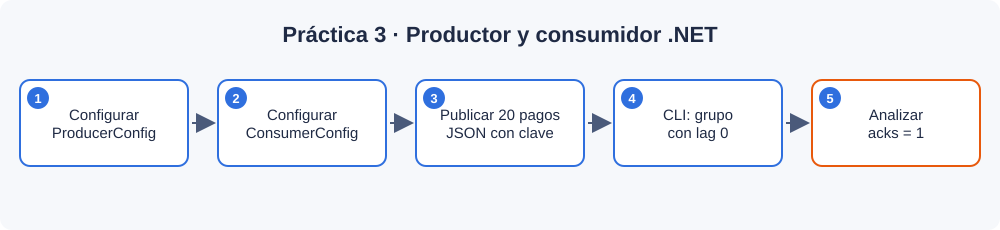

<!--
Pendiente de validación por el instructor: confirmar contra el repositorio de código preparado
la ruta ~/kafka-ess-labs, los nombres de proyecto (src/Pagos.Producer, src/Pagos.Consumer),
los argumentos de línea de comandos y la ubicación de los bloques "TODO ACT-03". Eliminar este comentario al validar.
-->

# Práctica 3. Conectar un productor C#/.NET con un consumidor C#/.NET

**Capítulo 3. Clientes .NET con C#**

⏱️ **Duración:** 50 min · 🛠️ **Herramienta:** .NET 10 con Confluent.Kafka 2.16 y CLI de Kafka 4.2 · 📄 **Entregable:** Bitácora ACT-03

## Descripción

El área de pagos de la entidad financiera ficticia publica cada pago desde un servicio .NET, y un servicio .NET independiente los procesa. Ambos comparten solo el contrato JSON del pago y el topic. En esta práctica el participante completa la configuración de los dos clientes preparados, publica pagos con el número de cuenta como clave, los procesa desde el consumidor y explica con la CLI qué garantías aporta cada propiedad. También fija el particionador para que una cuenta caiga en la misma partición sin importar si publica .NET, la CLI o el HTTP Bridge.

## Objetivos de aprendizaje

Al finalizar la práctica, el participante será capaz de:

- Configurar `ProducerConfig` con idempotencia y el particionador `murmur2_random`, y explicar el valor predeterminado de `acks`.
- Configurar `ConsumerConfig` con `group.id` y `auto.offset.reset`, y explicar la confirmación de offsets.
- Comprobar el intercambio de pagos JSON entre dos aplicaciones .NET independientes.
- Explicar qué se perdería al bajar `acks` a 1 y por qué exige desactivar la idempotencia.



## Antes de empezar

| Elemento | Valor |
|---|---|
| Dónde trabajar | Terminal de la máquina virtual y editor de código (Visual Studio Code) |
| Código de la práctica | `~/kafka-ess-labs/src/Pagos.Producer` y `~/kafka-ess-labs/src/Pagos.Consumer` |
| Variable de conexión | `$BOOTSTRAP` (definida en el [Setup Guide](../../Setup_Guide.md)) |
| Topic de la práctica | `pagos` (3 particiones), que se reutiliza hasta la Práctica 6 |
| Grupo de consumidores | `pagos-dotnet-[INICIALES]` |
| Nombre del entregable | `ACT03_Bitacora_[INICIALES].md` en `~/entregables/` |

> Sustituya `[INICIALES]` por sus iniciales en minúsculas. Todos los datos de la práctica son ficticios.

<!-- Nota para el instructor: la conexión con TLS y autenticación se explica en el tema 3.2; el entorno de práctica usa un listener sin cifrado. -->

---

## Tarea 1. Preparar el código y el topic de pagos (6 min)

**Objetivo:** Tener el código actualizado, ambos proyectos compilando y el topic `pagos` creado con 3 particiones.

**Por qué:** Los dos servicios son aplicaciones independientes. Antes de configurarlas hay que confirmar que compilan y que el topic que comparten existe.

**Paso 1.** Actualizar el repositorio de código y compilar ambos proyectos:

```bash
cd ~/kafka-ess-labs && git pull
dotnet build src/Pagos.Producer && dotnet build src/Pagos.Consumer
```

- **Qué verás:** `Build succeeded` dos veces, con `0 Error(s)`.
- **Si no ocurre así:** si `dotnet` no se encuentra o falla la restauración de `Confluent.Kafka`, revisar la sección *Troubleshooting* del [Setup Guide](../../Setup_Guide.md).

**Paso 2.** Crear el topic `pagos`:

```bash
kafka-topics.sh --bootstrap-server $BOOTSTRAP \
  --create --topic pagos --partitions 3 --replication-factor 1
```

**Paso 3.** Abrir el código en el editor con `code ~/kafka-ess-labs` y crear la bitácora:

```bash
printf '# ACT-03. Bitácora\n\n## Predicción\nCon acks=1 en lugar de all, podría perderse un pago si...\n\n' \
  > ~/entregables/ACT03_Bitacora_[INICIALES].md
```

**Paso 4.** Completar la predicción en la bitácora antes de continuar.

**Al terminar esta tarea debes tener:**

- ✔ Ambos proyectos compilados sin errores.
- ✔ El topic `pagos` con 3 particiones.

---

## Tarea 2. Configurar el productor (10 min)

**Objetivo:** Tener el bloque `ProducerConfig` del productor con idempotencia explícita, particionador `murmur2_random` y sin fijar `acks`.

**Por qué:** La configuración del productor define la garantía de entrega. La idempotencia evita duplicados por reintentos y el particionador asegura que una cuenta caiga en la misma partición que cuando publica la CLI o el HTTP Bridge.

**Paso 1.** En el editor, abrir `src/Pagos.Producer/Program.cs` y localizar el comentario `// TODO ACT-03`.

**Paso 2.** Completar el bloque `ProducerConfig` para que quede así:

```csharp
var config = new ProducerConfig
{
    BootstrapServers = Environment.GetEnvironmentVariable("BOOTSTRAP"),
    ClientId = "pagos-producer-[INICIALES]",
    EnableIdempotence = true,
    Partitioner = Partitioner.Murmur2Random
    // Acks no se fija: Confluent.Kafka aplica Acks.All por defecto
};
```

- **Importante:** el cliente .NET usa por defecto `consistent_random` (CRC32), distinto del particionador de la CLI y del HTTP Bridge (murmur2). Sin `Murmur2Random`, la misma cuenta podría caer en particiones distintas según quién publique.

**Paso 3.** Localizar en el mismo archivo la llamada `ProduceAsync` y comprobar que el mensaje usa la cuenta como clave:

```csharp
new Message<string, string> { Key = pago.Cuenta, Value = JsonSerializer.Serialize(pago) }
```

**Paso 4.** Guardar el archivo con **Ctrl+S** y compilar:

```bash
dotnet build src/Pagos.Producer
```

- **Qué verás:** `Build succeeded`.

**Paso 5.** Copiar el bloque `ProducerConfig` a la bitácora bajo `## Configuración del productor` y explicar en una línea cada propiedad: `EnableIdempotence`, `Partitioner` y el valor predeterminado de `Acks`.

**Al terminar esta tarea debes tener:**

- ✔ El productor configurado y compilado.
- ✔ La explicación de las tres propiedades en la bitácora.

---

## Tarea 3. Configurar el consumidor (8 min)

**Objetivo:** Tener el bloque `ConsumerConfig` del consumidor con `GroupId` y `AutoOffsetReset` definidos y la explicación de la confirmación automática de offsets.

**Por qué:** El `group.id` identifica quién lleva la posición en el registro y `auto.offset.reset` decide desde dónde empieza un grupo que aún no tiene offsets confirmados.

**Paso 1.** Abrir `src/Pagos.Consumer/Program.cs` y localizar el comentario `// TODO ACT-03`.

**Paso 2.** Completar el bloque `ConsumerConfig`:

```csharp
var config = new ConsumerConfig
{
    BootstrapServers = Environment.GetEnvironmentVariable("BOOTSTRAP"),
    GroupId = opciones.Grupo,                 // se recibe con --grupo
    AutoOffsetReset = AutoOffsetReset.Earliest,
    EnableAutoCommit = true                   // valor predeterminado; se cambia en la Práctica 5
};
```

**Paso 3.** Guardar y compilar:

```bash
dotnet build src/Pagos.Consumer
```

**Paso 4.** Agregar a la bitácora, bajo `## Configuración del consumidor`, el bloque y una línea por propiedad.

- **Importante:** en un clúster corporativo se agregan además `SecurityProtocol = SecurityProtocol.SaslSsl`, `SaslMechanism`, `SaslUsername`, `SaslPassword` y `SslCaLocation`. El entorno del curso usa un listener sin cifrado; no configurarlas aquí ni escribir credenciales en el código.

**Al terminar esta tarea debes tener:**

- ✔ El consumidor configurado y compilado.
- ✔ La explicación de `GroupId`, `AutoOffsetReset` y `EnableAutoCommit`.

---

## Tarea 4. Publicar y procesar pagos entre las dos aplicaciones (10 min)

**Objetivo:** Obtener la salida del consumidor .NET con los 20 pagos publicados por el productor .NET, cada uno con su partición, offset y cuenta.

**Por qué:** Las dos aplicaciones no se conocen entre sí. El desacople se comprueba cuando el consumidor procesa lo que publica el productor solo a través del topic y del contrato JSON.

**Paso 1.** En **T2**, iniciar el consumidor:

```bash
cd ~/kafka-ess-labs
dotnet run --project src/Pagos.Consumer -- --grupo pagos-dotnet-[INICIALES] | tee ~/entregables/act03-consumidor.txt
```

- **Qué verás:** el mensaje de suscripción al topic `pagos` y la asignación de las particiones 0, 1 y 2.

**Paso 2.** En **T1**, publicar 20 pagos:

```bash
cd ~/kafka-ess-labs
dotnet run --project src/Pagos.Producer -- --cantidad 20 | tee ~/entregables/act03-productor.txt
```

- **Qué verás:** en **T1**, 20 líneas con la partición y el offset asignados a cada pago; en **T2**, los mismos 20 pagos procesados.

**Paso 3.** Comprobar que los pagos de una misma cuenta tienen siempre la misma partición:

```bash
grep CTA-1001 ~/entregables/act03-productor.txt
```

**Paso 4.** Dejar el consumidor en ejecución y copiar ambas salidas a la bitácora bajo `## Evidencia 1. Intercambio .NET`.

**Al terminar esta tarea debes tener:**

- ✔ Los 20 pagos publicados y procesados.
- ✔ Las salidas del productor y del consumidor guardadas.

---

## Tarea 5. Observar offsets y grupo con la CLI (6 min)

**Objetivo:** Obtener la descripción del grupo `pagos-dotnet-[INICIALES]` con lag cero y la evidencia de que la CLI publica una cuenta en la misma partición que el productor .NET.

**Por qué:** La CLI muestra desde el clúster lo que hicieron las aplicaciones: cuánto publicó el productor, hasta dónde confirmó el consumidor y si el particionador coincide.

**Paso 1.** En **T3**, describir el grupo:

```bash
kafka-consumer-groups.sh --bootstrap-server $BOOTSTRAP --describe --group pagos-dotnet-[INICIALES]
```

- **Qué verás:** tres filas, una por partición, con `LAG 0` y un `CONSUMER-ID` que empieza con el nombre del cliente .NET.

**Paso 2.** Publicar desde la CLI un pago de la cuenta `CTA-1001`:

```bash
echo 'CTA-1001|{"idPago":"P-CLI-01","cuenta":"CTA-1001","monto":1.00,"moneda":"MXN"}' | \
kafka-console-producer.sh --bootstrap-server $BOOTSTRAP --topic pagos \
  --property parse.key=true --property key.separator='|'
```

- **Qué verás:** en **T2**, el consumidor .NET procesa `P-CLI-01` en la misma partición que los pagos de `CTA-1001` de la Tarea 4.
- **Si no ocurre así:** si la partición es distinta, revisar que `Partitioner = Partitioner.Murmur2Random` esté guardado y que el productor se haya vuelto a compilar.

**Paso 3.** Copiar ambas salidas a la bitácora bajo `## Evidencia 2. CLI`.

**Al terminar esta tarea debes tener:**

- ✔ El grupo con lag cero.
- ✔ La coincidencia de partición entre .NET y la CLI.

---

## Tarea 6. Analizar el efecto de bajar acks a 1 (10 min)

**Objetivo:** Tener en la bitácora el error obtenido al combinar `acks=1` con idempotencia y una explicación de qué pagos se podrían perder con `acks=1`.

**Por qué:** Con `acks=all` el broker confirma cuando todas las réplicas sincronizadas tienen el pago; con `acks=1` confirma solo el líder. En un clúster con réplicas, si el líder falla antes de replicar, el pago confirmado se pierde.

**Paso 1.** En `src/Pagos.Producer/Program.cs`, agregar temporalmente `Acks = Acks.Leader,` dentro de `ProducerConfig`, guardar y ejecutar:

```bash
dotnet run --project src/Pagos.Producer -- --cantidad 1
```

- **Qué verás:** un error de configuración que indica que la idempotencia requiere `acks=all`.

**Paso 2.** Cambiar `EnableIdempotence = true` por `EnableIdempotence = false`, guardar y volver a ejecutar el comando del paso 1.

- **Qué verás:** el pago se publica sin error.

**Paso 3.** Agregar a la bitácora, bajo `## Análisis de acks`, el error del paso 1 y una explicación de tres a cinco líneas que responda: qué confirma el broker con `acks=1`, qué pago se perdería y en qué situación, por qué la idempotencia exige `acks=all` y por qué en este entorno de un solo broker no se puede observar la pérdida. Comparar con la predicción inicial.

**Paso 4.** Restaurar la configuración de la Tarea 2: eliminar la línea `Acks = Acks.Leader,`, volver a poner `EnableIdempotence = true`, guardar y compilar con `dotnet build src/Pagos.Producer`.

**Paso 5.** Detener el consumidor de **T2** con **Ctrl+C** y comprobar de nuevo el grupo con el comando de la Tarea 5, paso 1.

- **Qué verás:** `LAG 0` en las tres particiones.

**Al terminar esta tarea debes tener:**

- ✔ El análisis de `acks` en la bitácora.
- ✔ El productor restaurado con idempotencia y sin `acks` fijado.

---

## Validación y pruebas

| Caso | Acción | Resultado esperado |
|---|---|---|
| Caso 1 | Publicar 20 pagos con el productor .NET | El consumidor .NET procesa los 20 pagos |
| Caso 2 | Publicar `CTA-1001` desde la CLI | Cae en la misma partición que los pagos .NET de `CTA-1001` |
| Caso 3 | Describir el grupo al terminar | `LAG 0` en las tres particiones |
| Caso adversarial | Fijar `Acks.Leader` con `EnableIdempotence = true` | El cliente rechaza la configuración |

## Resultado esperado

- El consumidor .NET procesa los eventos publicados por el productor .NET.
- La explicación describe la configuración de `ProducerConfig` y el efecto de bajar `acks`.
- La CLI muestra el grupo con lag cero al terminar.

**Entregable:** Configuración de ambos clientes, salidas de ejecución y de la CLI y una explicación de cada propiedad revisada (`ACT03_Bitacora_[INICIALES].md`).

<!-- Agregar captura del resultado final: ../../images/p03-resultado.png -->

## Solución de problemas

**El productor no se conecta**
- *Síntoma:* el productor queda esperando y muestra `Local: Message timed out` o `Connection refused`.
- *Causa:* la variable `BOOTSTRAP` no está exportada en esa terminal.
- *Solución:* ejecutar `source ~/.kafka-curso.env` y `echo $BOOTSTRAP`, y volver a ejecutar.

**El consumidor no recibe pagos**
- *Síntoma:* el consumidor arranca, pero no procesa pagos.
- *Causa:* el grupo ya tenía offsets confirmados al final del topic o el consumidor está suscrito a otro topic.
- *Solución:* describir el grupo con la CLI; si el lag es 0, publicar nuevos pagos o usar otro nombre de grupo.

**Error de compilación en `Partitioner`**
- *Síntoma:* `The name 'Partitioner' does not exist in the current context`.
- *Causa:* falta la directiva `using Confluent.Kafka;` o hay un error de escritura.
- *Solución:* comprobar la directiva al inicio del archivo y el nombre `Partitioner.Murmur2Random`.

## Limpieza

- Detener productor y consumidor. Conservar el topic `pagos`, el grupo y los cambios en el código, que se reutilizan en las prácticas 4 a 6.

## Recursos opcionales

- [Confluent. Cliente .NET para Apache Kafka 2.16](https://docs.confluent.io/kafka-clients/dotnet/2.16/overview.html)
- [Confluent.Kafka en NuGet](https://www.nuget.org/packages/Confluent.Kafka)

<sub>Complejidad: Intermedia · Nivel de Bloom: Aplicar · Resultado de aprendizaje que verifica: R3</sub>

---

[⬅ Anterior: Práctica 2](../../Capitulo02/Practica02/README.md) | [Inicio](../../README.md) | [Siguiente: Práctica 4 ➡](../Practica04/README.md)
