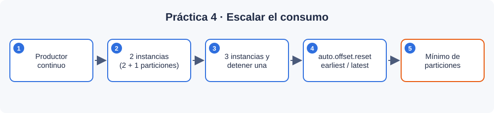

<!--
Pendiente de validación por el instructor: confirmar contra el repositorio de código preparado
los argumentos --continuo (productor) y --grupo, --reset (consumidor). Eliminar este comentario al validar.
-->

# Práctica 4. Escalar el consumo y estimar el número de particiones

**Capítulo 3. Clientes .NET con C#**

⏱️ **Duración:** 44 min · 🛠️ **Herramienta:** .NET 10 con Confluent.Kafka 2.16 y CLI de Kafka 4.2 · 📄 **Entregable:** Bitácora y hoja de dimensionamiento ACT-04

## Descripción

El volumen de pagos de la entidad financiera ficticia crece y el servicio consumidor ya no alcanza. En esta práctica el participante levanta varias instancias del consumidor .NET en el mismo grupo mientras el productor publica de forma continua, observa con la CLI cómo se reasignan las particiones al sumar y detener instancias, compara `auto.offset.reset` con un grupo nuevo y, con el throughput pico calculado en la Práctica 2, estima el número mínimo de particiones que necesitaría el topic.

## Objetivos de aprendizaje

Al finalizar la práctica, el participante será capaz de:

- Escalar el consumo con varias instancias de un consumidor .NET en el mismo grupo.
- Interpretar con la CLI las reasignaciones al sumar y detener instancias.
- Distinguir el efecto de `earliest` y `latest` en un grupo sin offsets confirmados.
- Calcular un mínimo inicial de particiones a partir del throughput pico y de las capacidades por partición.



## Antes de empezar

| Elemento | Valor |
|---|---|
| Dónde trabajar | Terminal de la máquina virtual del curso, con cinco terminales disponibles |
| Código de la práctica | `~/kafka-ess-labs`, con la configuración de la Práctica 3 |
| Topic de la práctica | `pagos` (3 particiones) |
| Grupo de consumidores | `escala-[INICIALES]` |
| Dato de entrada | Throughput pico calculado en la Práctica 2, Tarea 6 |
| Nombre del entregable | `ACT04_Bitacora_[INICIALES].md` en `~/entregables/` |

> Sustituya `[INICIALES]` por sus iniciales en minúsculas. Todos los datos de la práctica son ficticios.

---

## Tarea 1. Iniciar el productor continuo y la primera instancia (6 min)

**Objetivo:** Tener el productor .NET publicando de forma continua y una instancia del consumidor del grupo `escala-[INICIALES]` con las tres particiones asignadas.

**Por qué:** Las reasignaciones solo se aprecian con tráfico constante: cada instancia muestra qué particiones procesa en cada momento.

**Paso 1.** Crear la bitácora con la predicción:

```bash
printf '# ACT-04. Bitácora\n\n## Predicción\nCon 2 instancias espero... Con 3 instancias espero... Si detengo una de 3...\n\n' \
  > ~/entregables/ACT04_Bitacora_[INICIALES].md
```

Completar la predicción con `nano` antes de continuar.

**Paso 2.** En **T1**, iniciar el productor continuo:

```bash
cd ~/kafka-ess-labs
dotnet run --project src/Pagos.Producer -- --continuo
```

- **Qué verás:** una línea por pago publicado, aproximadamente cada segundo, con su partición y offset.

**Paso 3.** En **T2**, iniciar la primera instancia del consumidor:

```bash
cd ~/kafka-ess-labs
dotnet run --project src/Pagos.Consumer -- --grupo escala-[INICIALES]
```

- **Qué verás:** la asignación de las particiones `[0, 1, 2]` y pagos procesados de las tres.

**Al terminar esta tarea debes tener:**

- ✔ El productor publicando de forma continua.
- ✔ Una instancia con las tres particiones.

---

## Tarea 2. Escalar a dos instancias (8 min)

**Objetivo:** Obtener el registro de asignación del grupo con dos instancias, una con dos particiones y otra con una.

**Por qué:** Al sumar una instancia, el grupo se rebalancea y redistribuye las particiones sin que el productor lo note.

**Paso 1.** En **T3**, iniciar la segunda instancia con el mismo comando de la Tarea 1, paso 3.

- **Qué verás:** en **T2**, un aviso de revocación y una nueva asignación más pequeña; en **T3**, la asignación de las particiones restantes.

**Paso 2.** En **T5**, esperar 10 segundos y registrar la asignación:

```bash
kafka-consumer-groups.sh --bootstrap-server $BOOTSTRAP --describe \
  --group escala-[INICIALES] --members --verbose | tee ~/entregables/act04-2instancias.txt
```

- **Qué verás:** dos miembros con `#PARTITIONS` 2 y 1.

**Paso 3.** Copiar el registro a la bitácora bajo `## Escenario 1. Dos instancias`.

**Al terminar esta tarea debes tener:**

- ✔ El registro de asignación con dos instancias.

---

## Tarea 3. Escalar a tres instancias y detener una (8 min)

**Objetivo:** Obtener dos registros de asignación: uno con tres instancias de una partición cada una y otro después de detener una instancia.

**Por qué:** Con tres particiones, tres instancias es el máximo paralelismo útil del grupo. Si una instancia cae, sus particiones pasan a las restantes.

**Paso 1.** En **T4**, iniciar la tercera instancia con el mismo comando. Esperar 10 segundos y registrar la asignación en **T5** guardando en `act04-3instancias.txt`.

- **Qué verás:** tres miembros con `#PARTITIONS 1`.

**Paso 2.** Detener la instancia de **T3** con **Ctrl+C**. Esperar 10 segundos y registrar la asignación guardando en `act04-detenida.txt`.

- **Qué verás:** dos miembros; uno de ellos vuelve a tener dos particiones. En **T1**, el productor siguió publicando sin interrupción.

**Paso 3.** Describir el lag del grupo:

```bash
kafka-consumer-groups.sh --bootstrap-server $BOOTSTRAP --describe --group escala-[INICIALES]
```

- **Qué verás:** un lag bajo y estable en las tres particiones: las instancias restantes absorben la carga.

**Paso 4.** Copiar los registros a la bitácora bajo `## Escenario 2. Tres instancias` y `## Escenario 3. Instancia detenida`, y contrastarlos con la predicción.

**Paso 5.** Detener las instancias de **T2** y **T4** con **Ctrl+C**. Dejar el productor de **T1** en ejecución.

**Al terminar esta tarea debes tener:**

- ✔ Los registros con tres instancias y con una instancia detenida.

---

## Tarea 4. Comparar auto.offset.reset con un grupo nuevo (8 min)

**Objetivo:** Obtener la evidencia de que un grupo nuevo con `latest` empieza en los pagos que llegan a partir de ese momento y uno con `earliest` empieza en el offset 0.

**Por qué:** `auto.offset.reset` solo decide el punto de partida de un grupo sin offsets confirmados. Elegir mal puede hacer que un servicio nuevo ignore el historial o lo reprocese completo.

**Paso 1.** En **T2**, iniciar un consumidor con un grupo nuevo y `latest`. Observar los primeros pagos y detenerlo con **Ctrl+C** después de 10 segundos:

```bash
dotnet run --project src/Pagos.Consumer -- --grupo nuevo-latest-[INICIALES] --reset latest
```

- **Qué verás:** solo los pagos que el productor publica a partir de ese momento, con offsets altos.

**Paso 2.** En **T2**, iniciar un consumidor con otro grupo nuevo y `earliest`. Detenerlo con **Ctrl+C** después de 10 segundos:

```bash
dotnet run --project src/Pagos.Consumer -- --grupo nuevo-earliest-[INICIALES] --reset earliest
```

- **Qué verás:** los primeros pagos del topic con offset 0 en cada partición, incluidos los de la Práctica 3.

**Paso 3.** Volver a iniciar el grupo `nuevo-latest-[INICIALES]`, esta vez con `--reset earliest`, y detenerlo después de 10 segundos.

- **Qué verás:** continúa desde su último offset confirmado; `earliest` ya no aplica porque el grupo tiene offsets.

**Paso 4.** Detener el productor de **T1** con **Ctrl+C**. Agregar a la bitácora, bajo `## auto.offset.reset`, las tres observaciones y una explicación de cuándo usar cada valor.

**Al terminar esta tarea debes tener:**

- ✔ La evidencia de `latest` y `earliest` con grupos nuevos.
- ✔ La explicación de por qué no aplica a un grupo con offsets.

---

## Tarea 5. Estimar el número mínimo de particiones (14 min)

**Objetivo:** Tener en la bitácora la hoja de dimensionamiento con el throughput pico, las capacidades por partición, el mínimo de particiones redondeado hacia arriba y la justificación del paralelismo.

**Por qué:** El número de particiones limita el paralelismo del grupo y agregar particiones después cambia la partición de muchas cuentas, lo que afecta el orden por cuenta. Por eso se estima desde el inicio.

**Paso 1.** Usar los datos del ejercicio:

| Dato | Valor |
|---|---|
| Throughput pico (de la Práctica 2) | 7.2 MB/s (6,000 mensajes/s × 1.2 KB) |
| Capacidad de producción por partición | 12 MB/s |
| Capacidad de consumo por partición (una instancia del consumidor) | 1.8 MB/s |

**Paso 2.** Agregar a la bitácora la sección `## Hoja de dimensionamiento` y calcular:

```text
Particiones por producción = throughput pico ÷ capacidad de producción por partición = 7.2 ÷ 12  = ____
Particiones por consumo    = throughput pico ÷ capacidad de consumo por partición    = 7.2 ÷ 1.8 = ____
Mínimo inicial de particiones = máximo de ambos valores, redondeado hacia arriba    = ____
```

**Paso 3.** Responder en la misma sección, con una o dos líneas cada una:

- ¿Cuántas instancias activas puede tener como máximo el grupo con el topic actual de 3 particiones, y alcanza para el pico?
- ¿Qué pasaría con el orden de los pagos por cuenta si se agregan particiones al topic `pagos` después de estar en uso?
- Si unas pocas cuentas concentran la mayoría de los pagos, ¿por qué la capacidad efectiva podría ser menor que la calculada?
- ¿Qué medirías (lag y rendimiento) para ajustar la estimación y por qué debe validarse con pruebas de carga?

**Paso 4.** Revisar que la bitácora tenga los tres escenarios de asignación, la sección de `auto.offset.reset` y la hoja de dimensionamiento:

```bash
grep -c "^## " ~/entregables/ACT04_Bitacora_[INICIALES].md
```

- **Qué verás:** 6 o más secciones.

**Al terminar esta tarea debes tener:**

- ✔ El mínimo de particiones calculado y justificado.
- ✔ Las respuestas sobre paralelismo, nuevas particiones, distribución desigual y validación.

---

## Validación y pruebas

| Caso | Acción | Resultado esperado |
|---|---|---|
| Caso 1 | Sumar una segunda instancia | Reasignación 2 + 1 particiones |
| Caso 2 | Detener una de tres instancias | Sus particiones pasan a las restantes y el lag se estabiliza |
| Caso 3 | Grupo nuevo con `latest` y con `earliest` | `latest` inicia en los pagos nuevos; `earliest` en el offset 0 |
| Caso 4 | Calcular el mínimo de particiones | máx(7.2 ÷ 12, 7.2 ÷ 1.8) = 4 particiones, redondeado hacia arriba |
| Caso adversarial | Levantar una cuarta instancia con 3 particiones | Queda sin asignación: no aumenta la capacidad de consumo |

## Resultado esperado

- El registro demuestra la reasignación entre instancias y distingue `earliest` y `latest`.
- El dimensionamiento toma el mayor valor entre ambos cocientes, reconoce el límite de paralelismo del grupo y aclara que la estimación debe validarse con pruebas de carga.

**Entregable:** Registro de asignaciones por escenario, explicación de `auto.offset.reset` y hoja breve con throughput pico, capacidades asumidas por partición, cálculo del mínimo de particiones y justificación del paralelismo requerido (`ACT04_Bitacora_[INICIALES].md`).

<!-- Agregar captura del resultado final: ../../images/p04-resultado.png -->

## Solución de problemas

**Las instancias tardan en recibir particiones**
- *Síntoma:* una instancia nueva tarda varios segundos en mostrar su asignación.
- *Causa:* el rebalanceo espera a que todos los miembros respondan.
- *Solución:* esperar 10 a 15 segundos antes de describir el grupo.

**El consumidor con `latest` no muestra nada**
- *Síntoma:* el consumidor no procesa pagos.
- *Causa:* el productor continuo no está en ejecución.
- *Solución:* comprobar que **T1** sigue publicando.

**Una instancia detenida sigue apareciendo como miembro**
- *Síntoma:* el describe muestra todavía al miembro detenido.
- *Causa:* la instancia se cerró sin abandonar el grupo y el clúster espera a que expire su sesión.
- *Solución:* esperar unos 45 segundos y repetir el describe.

## Limpieza

- Detener productor y consumidores. Conservar el topic `pagos` y los grupos.

## Recursos opcionales

- [Confluent. Cliente .NET para Apache Kafka 2.16](https://docs.confluent.io/kafka-clients/dotnet/2.16/overview.html)
- [Apache Kafka 4.2. Design](https://kafka.apache.org/42/design/design/)

<sub>Complejidad: Intermedia · Nivel de Bloom: Analizar · Resultados de aprendizaje que verifica: R2 y R3</sub>

---

[⬅ Anterior: Práctica 3](../../Capitulo03/Practica03/README.md) | [Inicio](../../README.md) | [Siguiente: Práctica 5 ➡](../../Capitulo04/Practica05/README.md)
