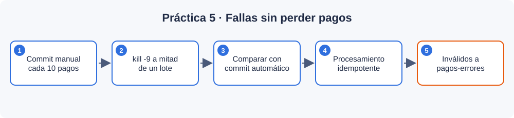

<!--
Pendiente de validación por el instructor: confirmar contra el repositorio de código preparado
los argumentos --invalidos (productor) y --retardo-ms, --salida (consumidor), los métodos Procesar(...)
y los bloques "TODO ACT-05". Eliminar este comentario al validar.
-->

# Práctica 5. Provocar fallas en el consumidor sin perder pagos

**Capítulo 4. Errores, reproceso y sistemas sin cliente Kafka**

⏱️ **Duración:** 63 min · 🛠️ **Herramienta:** .NET 10 con Confluent.Kafka 2.16 y CLI de Kafka 4.2 · 📄 **Entregable:** Bitácora ACT-05

## Descripción

El servicio consumidor de la entidad financiera ficticia registra cada pago en un archivo de resultados. Si el servicio se cae a mitad de un lote, al reiniciar puede reprocesar pagos; si recibe un evento mal formado, no puede quedarse detenido. En esta práctica el participante interrumpe el consumidor de forma abrupta, observa qué se reprocesa con la confirmación manual y con la automática, hace el procesamiento idempotente y envía los eventos inválidos a un topic de errores para continuar con el siguiente pago.

## Objetivos de aprendizaje

Al finalizar la práctica, el participante será capaz de:

- Explicar qué eventos se reprocesan tras una falla según el momento en que se confirma el offset.
- Distinguir la entrega como máximo una vez y al menos una vez a partir de lo observado.
- Ajustar el procesamiento para que un duplicado no altere el resultado.
- Registrar eventos inválidos en un topic de errores sin detener el consumo.



## Antes de empezar

| Elemento | Valor |
|---|---|
| Dónde trabajar | Terminal de la máquina virtual y editor de código |
| Código de la práctica | `~/kafka-ess-labs/src/Pagos.Consumer/Program.cs` |
| Topics de la práctica | `pagos` (existente) y `pagos-errores` (se crea en la Tarea 5) |
| Grupo de consumidores | `pagos-act05-[INICIALES]` |
| Archivo de resultados | `~/act05/resultado.csv` (una línea por pago procesado) |
| Nombre del entregable | `ACT05_Bitacora_[INICIALES].md` en `~/entregables/` |

> Sustituya `[INICIALES]` por sus iniciales en minúsculas. Todos los datos de la práctica son ficticios.

---

## Tarea 1. Desactivar la confirmación automática y confirmar por lotes (10 min)

**Objetivo:** Tener el consumidor con `EnableAutoCommit = false` y una confirmación manual cada 10 pagos procesados, compilado y posicionado al final del topic `pagos`.

**Por qué:** Confirmar después de procesar garantiza que ningún pago se dé por leído sin haberse registrado. Confirmar cada 10 pagos, y no uno por uno, es habitual por rendimiento, y crea una ventana de reproceso que se observará en la Tarea 2.

**Paso 1.** Crear la carpeta de trabajo y la bitácora con la predicción:

```bash
mkdir -p ~/act05
printf '# ACT-05. Bitácora\n\n## Predicción\nSi el consumidor se cae después de procesar 15 pagos y confirma cada 10, al reiniciar espero...\n\n' \
  > ~/entregables/ACT05_Bitacora_[INICIALES].md
```

Completar la predicción con `nano`.

**Paso 2.** En `src/Pagos.Consumer/Program.cs`, cambiar en `ConsumerConfig`:

```csharp
EnableAutoCommit = false
```

**Paso 3.** Localizar el ciclo de lectura (comentario `// TODO ACT-05: confirmación`) y dejarlo así:

```csharp
var procesados = 0;
while (!cts.IsCancellationRequested)
{
    var resultado = consumer.Consume(cts.Token);
    Procesar(resultado);                       // escribe la línea en resultado.csv
    procesados++;
    if (procesados % 10 == 0)
    {
        consumer.Commit();                     // confirma la posición procesada de todas las particiones asignadas
        Console.WriteLine($"COMMIT tras {procesados} pagos");
    }
}
```

**Paso 4.** Guardar, compilar y posicionar el grupo nuevo al final del topic para empezar sin historial:

```bash
cd ~/kafka-ess-labs && dotnet build src/Pagos.Consumer
kafka-consumer-groups.sh --bootstrap-server $BOOTSTRAP --group pagos-act05-[INICIALES] \
  --topic pagos --reset-offsets --to-latest --execute
```

- **Qué verás:** `Build succeeded` y una tabla con el `NEW-OFFSET` de cada partición.

**Al terminar esta tarea debes tener:**

- ✔ Confirmación manual cada 10 pagos.
- ✔ El grupo `pagos-act05-[INICIALES]` posicionado al final de `pagos`.

---

## Tarea 2. Interrumpir el consumidor a mitad de un lote (12 min)

**Objetivo:** Obtener la lista de pagos que aparecen dos veces en `resultado.csv` después de matar el consumidor y reiniciarlo.

**Por qué:** Un proceso que muere de forma abrupta no confirma lo último que procesó. Al reiniciar, el grupo retoma desde el último offset confirmado y esos pagos se vuelven a procesar: es la entrega al menos una vez.

**Paso 1.** En **T1**, publicar 30 pagos:

```bash
dotnet run --project src/Pagos.Producer -- --cantidad 30
```

**Paso 2.** En **T2**, iniciar el consumidor con un retardo de 1 segundo por pago:

```bash
rm -f ~/act05/resultado.csv
dotnet run --project src/Pagos.Consumer -- --grupo pagos-act05-[INICIALES] \
  --retardo-ms 1000 --salida ~/act05/resultado.csv
```

- **Qué verás:** un pago procesado por segundo y una línea `COMMIT` cada 10 pagos.

**Paso 3.** Cuando hayan aparecido entre 13 y 17 pagos procesados después del primer `COMMIT`, en **T3** matar el proceso sin darle oportunidad de cerrar:

```bash
pkill -9 -f Pagos.Consumer
```

- **Qué verás:** en **T2**, el proceso termina con `Killed`, sin mensajes de cierre.

**Paso 4.** Copiar `resultado.csv` antes del reinicio y volver a ejecutar en **T2** el comando del paso 2 sin el `rm`, esperando a que termine de procesar:

```bash
cp ~/act05/resultado.csv ~/act05/antes-de-reiniciar.csv
dotnet run --project src/Pagos.Consumer -- --grupo pagos-act05-[INICIALES] \
  --retardo-ms 1000 --salida ~/act05/resultado.csv
```

Detenerlo con **Ctrl+C** cuando deje de procesar pagos.

**Paso 5.** Identificar los pagos reprocesados:

```bash
cut -d, -f1 ~/act05/resultado.csv | sort | uniq -d | tee ~/act05/duplicados-manual.txt
```

- **Qué verás:** los identificadores de los pagos procesados después del último `COMMIT` y antes del `kill`.

**Paso 6.** Copiar `antes-de-reiniciar.csv`, las líneas `COMMIT` y `duplicados-manual.txt` a la bitácora bajo `## Evidencia 1. Confirmación manual` y explicar por qué se repitieron exactamente esos pagos.

**Al terminar esta tarea debes tener:**

- ✔ La lista de pagos reprocesados.
- ✔ La explicación ligada al último offset confirmado.

---

## Tarea 3. Comparar con la confirmación automática (8 min)

**Objetivo:** Tener en la bitácora la comparación de ambos modos, con la evidencia de que la confirmación automática puede dar por leído un pago que no llegó a procesarse.

**Por qué:** En .NET, con la confirmación automática el offset se guarda al recibir el pago y se confirma en segundo plano cada 5 segundos, aunque el pago aún se esté procesando. Si el proceso muere en ese momento, el pago se pierde: es la entrega como máximo una vez.

**Paso 1.** En `ConsumerConfig`, cambiar temporalmente `EnableAutoCommit = true`, guardar y compilar.

**Paso 2.** Publicar 5 pagos y procesarlos con un retardo de 8 segundos por pago:

```bash
dotnet run --project src/Pagos.Producer -- --cantidad 5
dotnet run --project src/Pagos.Consumer -- --grupo pagos-act05-[INICIALES] \
  --retardo-ms 8000 --salida ~/act05/resultado-auto.csv
```

**Paso 3.** Cuando el consumidor muestre `Leído` para el segundo pago, contar 6 segundos y, en **T3**, ejecutar `pkill -9 -f Pagos.Consumer`.

**Paso 4.** Reiniciar el consumidor con el comando del paso 2 y detenerlo con **Ctrl+C** cuando deje de procesar. Contar los pagos registrados:

```bash
wc -l ~/act05/resultado-auto.csv
```

- **Qué verás:** 4 líneas en lugar de 5: el segundo pago se confirmó antes de procesarse y no se reprocesó.
- **Si no ocurre así:** si aparecen 5 líneas, el `kill` ocurrió antes de la confirmación automática; repetir los pasos 2 a 4 esperando 7 segundos.

**Paso 5.** Restaurar `EnableAutoCommit = false`, guardar y compilar. Agregar a la bitácora, bajo `## Comparación de modos de confirmación`, una tabla con columnas *Modo*, *Qué ocurrió tras la falla*, *Garantía (al menos una vez / como máximo una vez)* y *Riesgo para los pagos*.

**Al terminar esta tarea debes tener:**

- ✔ La evidencia del pago perdido con la confirmación automática.
- ✔ La tabla comparativa y la confirmación manual restaurada.

---

## Tarea 4. Hacer idempotente el procesamiento (10 min)

**Objetivo:** Obtener un `resultado.csv` sin duplicados después de repetir la interrupción abrupta de la Tarea 2.

**Por qué:** El reproceso no se puede evitar si se quiere no perder pagos. Lo que sí se puede garantizar es que procesar dos veces el mismo pago no altere el resultado, usando el `idPago` como identificador único.

**Paso 1.** En `Program.cs`, localizar el método `Procesar` (comentario `// TODO ACT-05: idempotencia`) y agregar la comprobación al inicio:

```csharp
static readonly HashSet<string> yaProcesados = new();

static void Procesar(ConsumeResult<string, string> r)
{
    var pago = JsonSerializer.Deserialize<Pago>(r.Message.Value)!;
    if (yaProcesados.Count == 0 && File.Exists(rutaSalida))
        foreach (var linea in File.ReadLines(rutaSalida))
            yaProcesados.Add(linea.Split(',')[0]);

    if (!yaProcesados.Add(pago.IdPago))
    {
        Console.WriteLine($"DUPLICADO ignorado {pago.IdPago}");
        return;
    }
    File.AppendAllText(rutaSalida, $"{pago.IdPago},{pago.Cuenta},{pago.Monto}\n");
}
```

**Paso 2.** Guardar y compilar. Repetir la Tarea 2, pasos 1 a 4, usando como salida `~/act05/resultado-idem.csv`.

- **Qué verás:** al reiniciar, líneas `DUPLICADO ignorado` para los pagos posteriores al último `COMMIT`.

**Paso 3.** Comprobar que no hay duplicados:

```bash
cut -d, -f1 ~/act05/resultado-idem.csv | sort | uniq -d | wc -l
```

- **Qué verás:** `0`.

**Paso 4.** Copiar el método `Procesar` y la salida a la bitácora bajo `## Ajuste de idempotencia`.

**Al terminar esta tarea debes tener:**

- ✔ El procesamiento idempotente aplicado.
- ✔ Cero duplicados tras repetir la falla.

---

## Tarea 5. Enviar los eventos inválidos a un topic de errores (15 min)

**Objetivo:** Tener el consumidor registrando cada evento inválido en `pagos-errores` y continuando con el siguiente pago.

**Por qué:** Un evento mal formado no debe detener el procesamiento de los pagos válidos ni descartarse sin rastro. El topic de errores conserva el evento original para revisarlo y, si procede, reprocesarlo.

**Paso 1.** Crear el topic de errores:

```bash
kafka-topics.sh --bootstrap-server $BOOTSTRAP --create --topic pagos-errores \
  --partitions 1 --replication-factor 1
```

**Paso 2.** Publicar 20 pagos con 3 eventos inválidos intercalados y ejecutar el consumidor actual:

```bash
dotnet run --project src/Pagos.Producer -- --cantidad 20 --invalidos 3
dotnet run --project src/Pagos.Consumer -- --grupo pagos-act05-[INICIALES] \
  --salida ~/act05/resultado-idem.csv
```

- **Qué verás:** el consumidor termina con una excepción `JsonException` en el primer evento inválido. Al reiniciarlo, vuelve a fallar en el mismo evento: el consumo queda detenido.

**Paso 3.** Agregar al consumidor un productor para el topic de errores y envolver `Procesar` en el ciclo de lectura (comentario `// TODO ACT-05: errores`):

```csharp
using var productorErrores = new ProducerBuilder<string, string>(
    new ProducerConfig { BootstrapServers = config.BootstrapServers, EnableIdempotence = true }).Build();

// dentro del ciclo, en lugar de Procesar(resultado);
try
{
    Procesar(resultado);
}
catch (JsonException ex)
{
    productorErrores.Produce("pagos-errores", new Message<string, string>
    {
        Key = resultado.Message.Key,
        Value = resultado.Message.Value,
        Headers = new Headers
        {
            { "error", Encoding.UTF8.GetBytes(ex.Message) },
            { "origen", Encoding.UTF8.GetBytes($"pagos/{resultado.Partition.Value}/{resultado.Offset.Value}") }
        }
    });
    productorErrores.Flush(TimeSpan.FromSeconds(5));
    Console.WriteLine($"INVALIDO enviado a pagos-errores: p={resultado.Partition.Value} o={resultado.Offset.Value}");
}
```

- **Importante:** el `Flush` antes de continuar asegura que el evento inválido quede en `pagos-errores` antes de que su offset se confirme.

**Paso 4.** Guardar, compilar y volver a ejecutar el consumidor con el comando del paso 2 (solo el consumidor). Detenerlo con **Ctrl+C** cuando deje de procesar.

- **Qué verás:** tres líneas `INVALIDO enviado a pagos-errores` y el resto de los pagos procesados.

**Al terminar esta tarea debes tener:**

- ✔ El topic `pagos-errores` con los eventos inválidos.
- ✔ El consumidor procesando los pagos válidos sin detenerse.

---

## Tarea 6. Verificar con la CLI y cerrar la bitácora (8 min)

**Objetivo:** Obtener las salidas de la CLI de `pagos-errores` con sus encabezados y del grupo con lag cero.

**Por qué:** La evidencia final debe mostrar desde el clúster que no quedó ningún pago pendiente y que los inválidos se conservaron.

**Paso 1.** Leer el topic de errores con sus encabezados:

```bash
kafka-console-consumer.sh --bootstrap-server $BOOTSTRAP --topic pagos-errores \
  --from-beginning --timeout-ms 10000 \
  --property print.key=true --property print.headers=true
```

- **Qué verás:** tres eventos con los encabezados `error` y `origen`.

**Paso 2.** Describir el grupo:

```bash
kafka-consumer-groups.sh --bootstrap-server $BOOTSTRAP --describe --group pagos-act05-[INICIALES]
```

- **Qué verás:** `LAG 0` en las tres particiones.

**Paso 3.** Copiar ambas salidas a la bitácora bajo `## Evidencia 2. Topic de errores y lag` y agregar `## Discrepancias` con las diferencias entre la predicción y lo observado.

**Al terminar esta tarea debes tener:**

- ✔ Los eventos inválidos visibles en `pagos-errores`.
- ✔ El grupo con lag cero y la bitácora completa.

---

## Validación y pruebas

| Caso | Acción | Resultado esperado |
|---|---|---|
| Caso 1 | Matar el consumidor con confirmación manual cada 10 pagos | Se reprocesan los pagos posteriores al último `COMMIT` |
| Caso 2 | Matar el consumidor con confirmación automática durante el procesamiento | Un pago queda confirmado sin procesarse |
| Caso 3 | Repetir la falla con el procesamiento idempotente | `resultado-idem.csv` no tiene duplicados |
| Caso 4 | Publicar 3 eventos inválidos | Aparecen en `pagos-errores` y el consumo continúa |
| Caso adversarial | Reiniciar el consumidor sin el manejo de errores | Falla siempre en el mismo evento inválido y el lag no baja |

## Resultado esperado

- El registro identifica los eventos reprocesados y tras el ajuste reprocesar no altera el resultado.
- Los eventos inválidos aparecen en el topic de errores.
- El grupo de consumidores termina con lag en cero.

**Entregable:** Registro de los eventos procesados antes y después de la falla, comparación entre ambos modos de confirmación, el ajuste aplicado al procesamiento y las salidas de la CLI del topic principal y del topic de errores (`ACT05_Bitacora_[INICIALES].md`).

<!-- Agregar captura del resultado final: ../../images/p05-resultado.png -->

## Solución de problemas

**`pkill` no encuentra el proceso**
- *Síntoma:* el comando no devuelve nada y el consumidor sigue en ejecución.
- *Causa:* el nombre del proceso es distinto.
- *Solución:* ejecutar `pgrep -af dotnet`, identificar el PID del consumidor y usar `kill -9 PID`.

**No aparecen duplicados tras el `kill`**
- *Síntoma:* `uniq -d` no devuelve nada en la Tarea 2.
- *Causa:* el proceso se detuvo justo después de un `COMMIT`.
- *Solución:* repetir la Tarea 2 matando el proceso a mitad del siguiente lote.

**El consumidor sigue fallando con eventos inválidos**
- *Síntoma:* la excepción continúa después del cambio.
- *Causa:* el proyecto no se volvió a compilar o el `catch` no envuelve la llamada a `Procesar`.
- *Solución:* ejecutar `dotnet build src/Pagos.Consumer` y comprobar el bloque `try/catch`.

## Limpieza

- Detener productor y consumidor. Conservar los cambios en el consumidor: la Práctica 6 los utiliza. Conservar los topics `pagos` y `pagos-errores`.

## Recursos opcionales

- [Apache Kafka 4.2. Design: semántica de entrega](https://kafka.apache.org/42/design/design/)
- [Confluent. Cliente .NET para Apache Kafka 2.16](https://docs.confluent.io/kafka-clients/dotnet/2.16/overview.html)

<sub>Complejidad: Avanzada · Nivel de Bloom: Crear · Resultado de aprendizaje que verifica: R4</sub>

---

[⬅ Anterior: Práctica 4](../../Capitulo03/Practica04/README.md) | [Inicio](../../README.md) | [Siguiente: Práctica 6 ➡](../../Capitulo04/Practica06/README.md)
