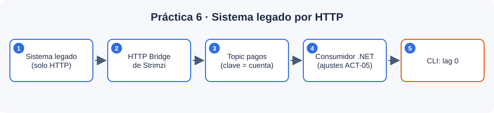

<!--
PLANTILLA COMPACTA DE README POR PRÁCTICA (versión 2.3: pasos detallados sin repeticiones dentro de la práctica: primera vez completo, después breve)
Uso: copiar este archivo como README.md dentro de CapituloNN/PracticaNN/ y reemplazar todo lo que está entre corchetes.
Eliminar este comentario y los comentarios de guía antes de publicar.

Reglas de redacción y duración (para el autor, no se publican):
- Pasos en verbo infinitivo, claros, concretos y en secuencia; un paso = una acción verificable.
- Incluir nombres exactos de opciones, archivos y valores; prompts listos para copiar en bloques ```text.
- La suma de minutos de las tareas debe ser igual a la duración del temario; considerar lectura, tiempos de respuesta de los agentes,
  validación y errores comunes de un participante real, no de un experto.
- Lo que se repite en todas las prácticas (prerrequisitos generales, entorno, versiones, credenciales) va en el README principal
  y en Setup_Guide.md, no aquí.
- No usar <details> ni llaves dobles de Liquid; usar rutas relativas sin espacios ni acentos.
-->

# Práctica 6. Publicar desde un sistema legado por HTTP

**Capítulo 4. Errores, reproceso y sistemas sin cliente Kafka**

⏱️ **Duración:** 25 min · 🛠️ **Herramienta:** [Agente o aplicación principal] · 📄 **Entregable:** [Nombre del entregable]

## Descripción

[3 a 4 líneas: escenario de negocio, qué hará el participante y qué valor obtendrá.]

## Objetivos de aprendizaje

Al finalizar la práctica, el participante será capaz de:

- [Objetivo 1, alineado con el temario]
- [Objetivo 2]
- [Objetivo 3]



## Antes de empezar

| Elemento | Valor |
|---|---|
| Dónde trabajar | [Aplicación > menú > opción] |
| Archivos de la práctica | [Archivo1.docx](recursos/Archivo1.docx), [Archivo2.xlsx](recursos/Archivo2.xlsx) |
| Ubicación en OneDrive | `Laboratorio_Copilot_ISA/PracticaNN/` |
| Dato clave del escenario | [Valor que el participante necesita tener a la mano] |
| Nombre del entregable | `[Nombre]_[INICIALES].docx` |

> Sustituya `[INICIALES]` por sus iniciales en nombres de archivo y prompts (por ejemplo, `Reporte_LMR.docx`). Todos los datos de la práctica son ficticios.

<!-- Opcional: una nota breve para el instructor (exposición previa, demostración, trabajo en paralelo). -->

---

<!--
Estructura obligatoria de cada tarea:
- Objetivo: el RESULTADO concreto y verificable que tendrá el participante (qué tabla, lista, archivo o confirmación), no la acción.
  Mal: "Relacionar hallazgos con prioridades". Bien: "Obtener una tabla de las 4 prioridades con nivel de contribución, evidencia y restricción".
- Por qué: una o dos líneas que conecten la tarea con el problema del escenario y con los datos concretos que el participante debe considerar.
- Pasos: una acción por paso. Indicar dónde hacer clic (ruta completa: aplicación > menú > opción), qué escribir (prompt completo),
  y debajo de cada paso las viñetas que apliquen: "Qué verás" (lo que aparece en pantalla), "Si no ocurre así" o "Alternativa"
  (qué hacer si algo falla), "Cómo insertar los archivos" (cuando el prompt referencia archivos) e "Importante" (advertencias).
  Para guardar, indicar la ruta completa: Archivo > Guardar como > OneDrive > Laboratorio_Copilot_ISA > Entregables y el nombre exacto.
- Primera vez completo, después breve: dentro de una misma práctica, los procedimientos que se repiten (abrir Copilot o un agente,
  insertar archivos con /, crear el documento de Word y pegar, guardar en Entregables) se explican completos solo la primera vez;
  las siguientes veces se escriben en una línea, por ejemplo "Guardar en `Entregables` con el nombre `X`, igual que antes".
  Cada práctica debe poder seguirse sin abrir otra práctica ni otro documento.
- No incluir viñetas obvias (por ejemplo, "Enviar: presionar Enter"); el paso ya dice "pegar el prompt y enviarlo".
  Evitar pasos vagos como "Revisar el resultado" o "Copiar a Word": decir qué revisar y dónde pegar y guardar.
- Al terminar esta tarea debes tener: 1 a 3 elementos comprobables que permitan al participante saber que puede continuar.
-->

## Tarea 1. [Nombre de la tarea] ([X] min)

**Objetivo:** [Resultado concreto: "Obtener una tabla de … con …"]

**Por qué:** [Relación con el escenario y los datos clave que deben considerarse.]

**Paso 1.** Abrir **Microsoft Edge**, escribir [m365.cloud.microsoft](https://m365.cloud.microsoft/) en la barra de direcciones y presionar **Enter**. Si se solicita, iniciar sesión con su cuenta corporativa.

- **Qué verás:** [Lo que aparece en pantalla al completar la acción.]
- **Alternativa:** [Si aparece algo distinto, qué hacer.]

**Paso 2.** En el panel izquierdo, seleccionar **[menú]**. Escribir `[nombre exacto]` en el cuadro de búsqueda y hacer clic en el resultado.

- **Qué verás:** [Confirmación visible, por ejemplo el nombre del agente encima del cuadro de mensaje.]
- **Si no ocurre así:** [Ruta alternativa o a quién avisar.]

**Paso 3.** Pegar el siguiente prompt y enviarlo:

```text
[Prompt completo, referenciando archivos con /Nombre_Archivo]
```

- **Cómo insertar los archivos:** cada texto que empieza con `/` es un archivo: borrarlo, escribir `/` y las primeras letras del nombre, y elegir el archivo en la lista. Si no aparece, usar **+** > **Cargar desde OneDrive** > `Laboratorio_Copilot_ISA/PracticaNN`.
- **Qué verás:** [Estructura esperada de la respuesta y tiempo aproximado.]

**Paso 4.** Comprobar que la respuesta incluya [datos concretos esperados, con cifras o nombres].

- **Si no ocurre así:** escribir *"[prompt de corrección]"*.

**Al terminar esta tarea debes tener:**

- ✔ [Elemento comprobable 1]
- ✔ [Elemento comprobable 2]

---

## Tarea 2. [Nombre de la tarea] ([X] min)

**Objetivo:** [Resultado concreto.]

**Por qué:** [Relación con el escenario.]

**Paso 1.** [Acción.]

**Paso 2.** [Acción y verificación.]

**Al terminar esta tarea debes tener:**

- ✔ [Elemento comprobable]

---

## Tarea N. [Nombre de la tarea] ([X] min)

**Objetivo:** Tener guardado `[Nombre]_[INICIALES].ext` con [secciones o contenido].

**Por qué:** [Para qué se usará el entregable.]

**Paso 1.** Abrir Word (escritorio o web) y crear un **Documento en blanco**. En Copilot, seleccionar **Copiar** debajo de [respuestas] y pegar en Word con **Ctrl+V**.

**Paso 2.** Agregar los títulos [lista de secciones] y mover cada contenido bajo el título que corresponda.

**Paso 3.** Seleccionar **Archivo > Guardar como**, elegir **OneDrive > Laboratorio_Copilot_ISA > Entregables** y guardar con el nombre `[Nombre]_[INICIALES].ext`.

**Al terminar esta tarea debes tener:**

- ✔ [Entregable con sus secciones]
- ✔ El archivo guardado en `Entregables`.

---

## Validación y pruebas

| Caso | Acción o prompt | Resultado esperado |
|---|---|---|
| Caso 1 | [Entrada] | [Resultado] |
| Caso 2 | [Entrada] | [Resultado] |
| Caso adversarial | [Entrada que intenta inducir un error] | [Respuesta correcta esperada] |

## Resultado esperado

- [Resultado 1]
- [Resultado 2]

**Entregable:** [Descripción exacta del entregable según el temario] (`[Nombre]_[INICIALES].ext`).


## Solución de problemas

**[Problema 1]**
- *Síntoma:* [Qué observa el participante]
- *Causa:* [Por qué ocurre]
- *Solución:* [Pasos concretos]

**[Problema 2]**
- *Síntoma:* [...]
- *Causa:* [...]
- *Solución:* [...]

## Limpieza

- [Acción 1, por ejemplo: no compartir el entregable; conservarlo en `Entregables`.]

## Recursos opcionales

- [Documentación oficial](https://learn.microsoft.com/)

<sub>Complejidad: [Fácil / Intermedia / Avanzada] · Nivel de Bloom: [Recordar / Comprender / Aplicar / Analizar / Evaluar / Crear]</sub>

---

[⬅ Anterior: Práctica 5](../../Capitulo04/Practica05/README.md) | [Inicio](../../README.md)
